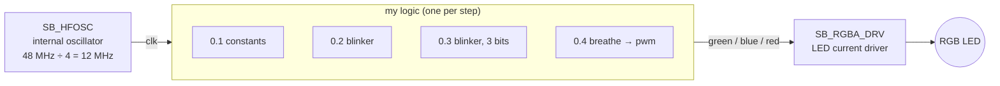
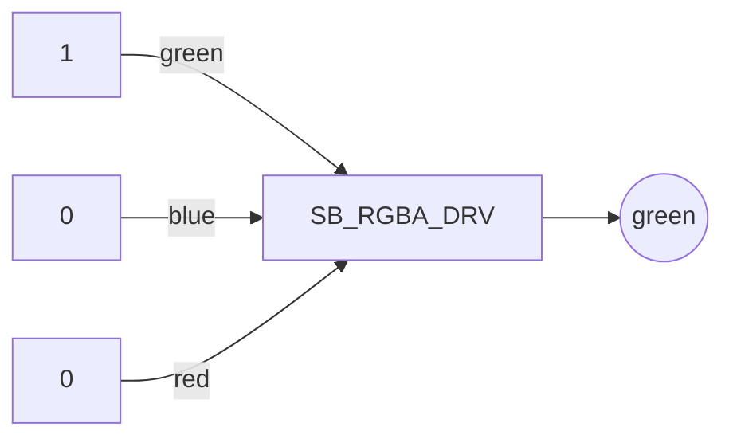
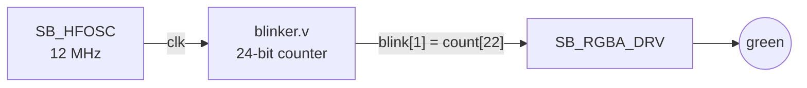
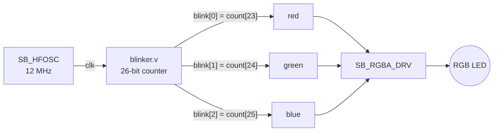
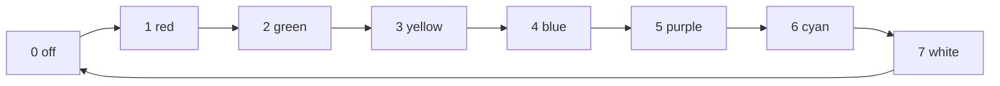
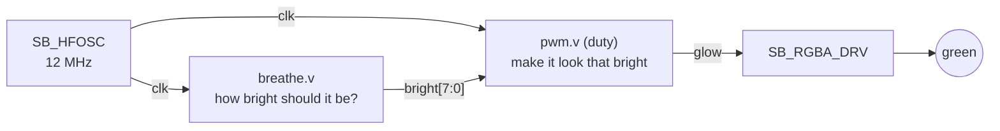

# Level 0 Report: LED Designs on the UPduino v3.0

**Board:** UPduino v3.0 (iCE40UP5K)  
**Toolchain:** Yosys → nextpnr-ice40 → icepack → iceprog for hardware · Icarus Verilog for simulation

## Summary

Built four LED designs from scratch in Verilog, each adding one new idea: a constant output, a counter that blinks, three counter bits that mix colors, and PWM brightness control. Every logic module was checked in simulation with its own testbench before going on the board. All four work on hardware. The largest design uses **48 of 5,280 logic cells (<1%)** and meets timing at **71.8 MHz** (it runs at 12 MHz).

This level was about learning the full FPGA workflow: write → simulate → synthesize → place & route → program.

## Architecture

Every design has the same frame. Only the logic in the middle changes:



| Part | Job | Picture |
|---|---|---|
| **SB_HFOSC** | Built-in clock: 12 million ticks per second | A metronome |
| **Counter** (`blinker.v`, `breathe.v`, `pwm.v`) | Adds 1 every tick; higher bits flip more slowly | A car's odometer |
| **PWM** (`pwm.v`) | Turns a number 0–255 into a brightness | Flicking a light switch very fast |
| **SB_RGBA_DRV** | Safely powers the LED pins. Channel 0 = green, 1 = blue, 2 = red | The power outlet |
| **`common/upduino.pcf`** | Pin map: green = 39, blue = 40, red = 41 | The address label on each wire |

Both `SB_` blocks are built into the iCE40 chip. In simulation they're blackboxes (no behavior), so the testbenches test only my logic.

## Results

| Step | Design | Idea | On the board |
|---|---|---|---|
| 0.1 | `top_on.v` | Fixed values into the LED driver (no clock); tests the toolchain | Solid green |
| 0.2 | `top_blink.v` + `blinker.v` | Counter as a clock divider | Green blinks |
| 0.3 | `top_colors.v` + `blinker.v` | 3 counter bits drive R/G/B → 8 states (off + 7 colors) | Color cycle, 0.7 s each |
| 0.4 | `top_breathe.v` + `pwm.v` + `breathe.v` | PWM sets brightness; a slow ramp drives the PWM | Fades in/out, ~5.6 s each way |

## How It Works

### 0.1 LED on: no clock, just wires



Three fixed values go straight into the driver. If this lights up, the whole toolchain and the pin map work.

### 0.2 Blink: a counter slows the clock down



Each counter bit flips **half as often** as the bit to its right. A bit high up flips slowly enough to see:

```
count bit 0:   ▀▄▀▄▀▄▀▄▀▄▀▄▀▄▀▄   flips every tick (12 MHz, far too fast to see)
count bit 22:  ▀▀▀▀▀▀▀▀▄▄▄▄▄▄▄▄   flips every 2²² ticks ≈ 0.35 s
```

`blinker.v` outputs the 3 top bits, `count[23:21]`. With `BITS = 24`, `blink[1]` is `count[22]`.

### 0.3 Colors: 3 bits = 8 colors



The 3 top bits count 0 → 7. Each number turns on a different mix of colors. Light mixes differently from paint, so red + green = yellow:



Each color lasts 2²³ ticks ≈ 0.7 s, so the full loop takes ~5.6 s.

### 0.4 Breathing: brightness from a number, and a number that rises and falls

**Idea.** An LED pin can only be fully on or fully off. To make it *look* dim, switch it on and off faster than the eye can see; the eye sees the average. Then slowly raise and lower that average, and the LED breathes.



1. **`pwm.v`: brightness from a number.** An 8-bit counter sweeps 0 → 255 about 47,000 times per second. The output is on while the counter is below `duty`.

   ```
   duty = 64:   ████░░░░░░░░░░░░   on 64/256 of the time  → 25% bright
   duty = 192:  ████████████░░░░   on 192/256 of the time → 75% bright
   ```

2. **`breathe.v`: the slow ramp.** A 27-bit counter.
   - Bits 25–18 (`level`) count 0 → 255, one step every 2¹⁸ ticks ≈ 22 ms, so ~5.6 s per ramp.
   - Bit 26 picks the direction. When it is 1, the output is `~level` (every bit flipped), which turns 0, 1 … 255 into 255, 254 … 0.
   - At the turn, `level` wraps to 0 and `~0 = 255`, so the brightness stays at the top instead of jumping to dark.

   ```mermaid
   flowchart LR
       UP["bit 26 = 0<br/>bright = level<br/>0 ↗ 255"] -- "~5.6 s" --> DOWN["bit 26 = 1<br/>bright = ~level<br/>255 ↘ 0"]
       DOWN -- "~5.6 s" --> UP
   ```

3. **`top_breathe.v`: connect them.** `bright` goes into `pwm`'s `duty`, and `pwm`'s output drives the green channel.

## Verification

Counter widths are **parameters**, so the same code runs with a tiny counter in simulation (fast) and the full counter on hardware.

| Module | Test | Result |
|---|---|---|
| `blinker.v` | 4-bit counter: check which counts set each output bit | ✓ |
| `pwm.v` | 4-bit: duty = 4 → on 4/16 ticks; duty = 12 → on 12/16 | ✓ |
| `breathe.v` | 10-bit counter: ramp 0 → 255 → 0 and the turnaround | ✓ |
| All designs | Synthesized, placed and routed, flashed to the board | ✓ |

## Reproduce

```bash
make TOP=top_on flash        # 0.1 solid green
make TOP=top_blink flash     # 0.2 blink
make TOP=top_colors flash    # 0.3 color cycle
make TOP=top_breathe flash   # 0.4 breathing

make sim                     # blinker testbench
make sim_pwm                 # pwm testbench
make sim_breathe             # breathe testbench
```

Pin constraints: `../common/upduino.pcf`
