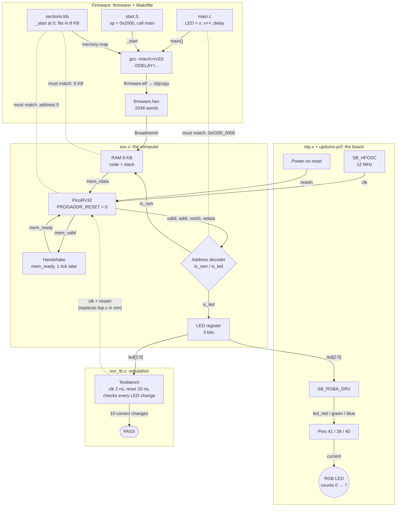
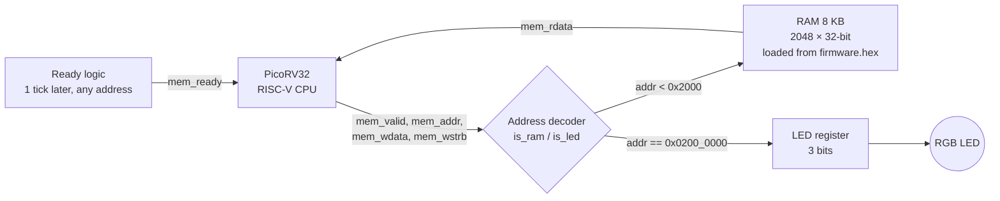
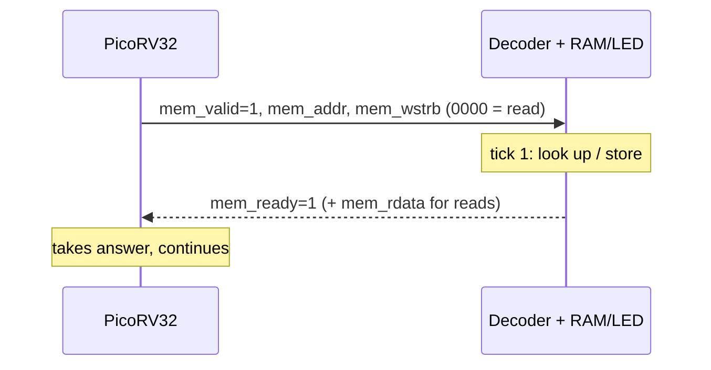
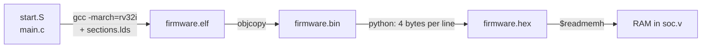
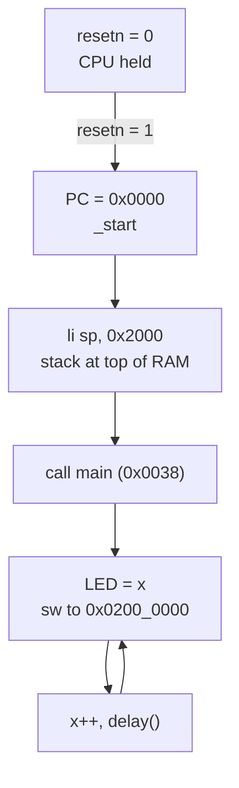

# Level 1 Report: A RISC-V Computer on the UPduino v3.0

**Board:** UPduino v3.0 (iCE40UP5K)  
**CPU:** [PicoRV32](https://github.com/YosysHQ/picorv32) (RV32I)  
**Toolchain:** `riscv-none-elf-gcc` for firmware · Yosys → nextpnr-ice40 → icepack → iceprog for hardware · Icarus Verilog for simulation

## Summary

Built a tiny computer, called a **SoC** (System on Chip), inside the FPGA. It has a RISC-V CPU, 8 KB of RAM, and a memory-mapped LED. A C program, cross-compiled for RISC-V and loaded into the RAM, counts `0, 1, 2, …` and writes each number to the LED, so the board steps through 8 colors.

The difference from Level 0: there, **hardware** counted. Here, **software running on a CPU I wired up** counts.

## System Map

Every component, from the C source to the two proofs that it works: the LED counting on the board, and `PASS` in simulation. Arrows show what each part **gives** to the next. Dotted links are values that must match across files.



| Must match | Where |
|---|---|
| LED address `0x0200_0000` | `main.c` `#define LED` = `soc.v` `LED_ADDR` |
| First instruction at address 0 | `sections.lds` (`_start` first) = `PROGADDR_RESET` in `soc.v` |
| RAM size 8 KB | `soc.v` `RAM_SIZE` = `sections.lds` `MEMORY` = `Makefile` hex padding (8192) |

## Architecture



| Part | Job | Picture |
|---|---|---|
| **PicoRV32** | Runs the program, one instruction at a time, starting at address 0 | The worker |
| **Address decoder** | Looks at each address and picks who answers | The post-office sorter |
| **RAM** | Holds the program and the stack; byte-writable | The notebook |
| **LED register** | Stores the last value written to `0x0200_0000`; its bits drive the LED | The magic mailbox |
| **Ready logic** | Answers every request one tick later so the CPU never hangs | The bell |

### Memory map

| Address | Size | What |
|---|---|---|
| `0x0000_0000 – 0x0000_1FFF` | 8 KB | RAM: code at the bottom, stack at the top (`sp = 0x2000`) |
| `0x0200_0000` | 4 B | LED register: bit 0 = red, bit 1 = green, bit 2 = blue |
| anything else | – | No device: the bus still answers, so the CPU doesn't freeze |

## How It Works

### 1. The bus: one request at a time

Every RAM read, RAM write, and LED write uses the same handshake: the CPU raises `mem_valid` and waits until `mem_ready` comes back.



- **Read vs write:** `mem_wstrb` has one bit per byte. `0000` means read. `1111` means write all 4 bytes (`sw`). `0001` means write only byte 0 (`sb`).
- **Ready rule:** `mem_ready <= mem_valid && !mem_ready`, so it rings once per request, one tick later.
- **Never hang:** ready is answered for *every* address. *Simplification:* real SoCs also report a bus error for unmapped addresses.

### 2. RAM: word lines, byte writes

- 2048 lines × 4 bytes. The line number is `mem_addr[12:2]`: dropping the low 2 bits divides by 4.
- `$readmemh("firmware/firmware.hex", ram)` loads the program into RAM at build time, so the code is already there at power-on.
- Writes happen only when `mem_valid && is_ram`, and only to bytes whose `mem_wstrb` bit is 1.

### 3. Firmware: from C to RAM



| File | Job |
|---|---|
| `start.S` | First code to run: set `sp = 0x2000`, call `main`, then park in a loop if `main` ever returns |
| `sections.lds` | Linker script: places `_start` at address 0, then the rest of the code and data, inside the 8 KB RAM |
| `main.c` | `LED = x; x++; delay(DELAY);` forever. `LED` is a `volatile` pointer to `0x0200_0000` |
| `Makefile` | Builds `.elf → .bin → .hex`; `make dump` shows the disassembly; `make sim` runs the testbench; `make flash` builds the bitstream and programs the board |

### 4. Boot: what happens after reset



`resetn` is active-low: 0 holds the CPU, 1 lets it run. `PROGADDR_RESET = 0x0000_0000` points the CPU at the first line of RAM, where `_start` is.

### Example: `x = 5`

```
x = 5 = 0b101   →   blue ON, green off, red ON   →   purple
```

## Verification

| Check                          | Method                                                                                                           | Result            |
| ------------------------------ | ---------------------------------------------------------------------------------------------------------------- | ----------------- |
| Firmware layout                | `make dump`: `_start` at `0x0`, `delay` at `0xc`, `main` at `0x38`; first hex words `00002137 034000ef 0000006f` | ✓                 |
| SoC compiles                   | `iverilog -o /dev/null soc.v picorv32.v`                                                                         | ✓                 |
| CPU writes 0, 1, 2… to the LED | `make sim`: `soc_tb.v` checks 10 LED changes (wrapping 7 → 0) against the expected count                         | ✓ PASS at 7087 ns |
| Runs on the board              | `make clean && make flash DELAY=300000`: the color changes about every 0.8 s                                     | ✓                 |

### Timing

| | One tick | One color | Notes |
|---|---|---|---|
| Simulation | 2 ns | 700 ns (DELAY=10) | First LED write at 787 ns |
| Board | 83 ns (12 MHz) | ~0.8 s (DELAY=300000) | Each `delay` loop iteration takes ~32 ticks |

### Classic mistake: the LED is solid, dim white

`make sim` builds the firmware with `DELAY=10`. If you then run `make flash` without `make clean`, Make sees `firmware.hex` as up to date and puts the **simulation** firmware on the board. `DELAY` is a variable, not a file, so Make can't tell that it changed. Each color then lasts ~30 µs, and all 8 colors cycle ~4000 times per second. The eye averages them into white.

**Rule:** always `make clean` when switching between simulation and the board. Check with `make dump`: `li a4,9` means DELAY=10.

## Reproduce

```bash
make clean && make sim                    # simulate (DELAY=10): prints PASS, writes soc.vcd
gtkwave soc.vcd                           # view the waveform
make clean && make flash DELAY=300000     # build the bitstream and program the board
make dump                                 # disassemble the firmware
```
