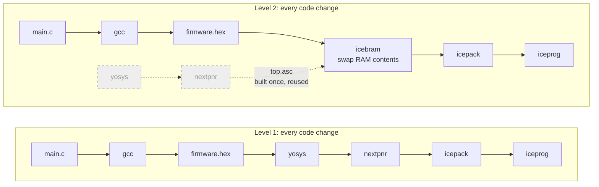

# Level 2 Report: Update the Firmware Without Rebuilding the Hardware

**Board:** UPduino v3.0 (iCE40UP5K) · **CPU:** [PicoRV32](https://github.com/YosysHQ/picorv32) · **Builds on:** [Level 1](../level1_SystemOnChip/RECAP.md)

## Summary

In Level 1, every change to `main.c` re-ran synthesis and place-and-route, even though only the RAM contents changed. Level 2 splits the build into two paths. The **hardware** is built once with a random placeholder in the RAM. The **firmware** is then swapped into the finished bitstream with `icebram`, without re-synthesis.

**Result:** time from code edit to the program running on the board went from **49.6 s → 7.4 s** (~6.7× faster).

## What Got Cut



Grey dashed boxes: steps that **no longer run** when only the firmware changes. They run only when a `.v` file, the `.pcf`, or `random.hex` changes.

## How It Works

| File | Change |
|---|---|
| `soc.v` | RAM init file is now a parameter: `parameter FIRMWARE = "firmware/firmware.hex"` |
| `top.v` | Overrides it for the board: `.FIRMWARE("firmware/random.hex")` |
| `Makefile` | `top.json` depends on `random.hex` (not `firmware.hex`); new `top_fw.asc` rule runs `icebram`; `top.bin` is packed from `top_fw.asc` |
| `soc_tb.v` | Unchanged: simulation uses the default, so it still runs the real firmware |

**Why a *random* placeholder?** Inside `top.asc`, nextpnr spreads the 8 KB RAM across 16 BRAM blocks in its own bit order. `icebram` finds that layout by searching for the placeholder's words, so every word must be unique. A mostly-zero firmware image would match in thousands of places.

**Keep** `random.hex` **with its** `top.asc`**.** They are a matched pair: regenerating one means rebuilding the other. The Makefile creates `random.hex` only if it is missing (fixed seed `-s 1` for reproducible builds), and `make clean` deletes both together.

## Verification

| Test                                                           | Result                                                                                                                          |
| -------------------------------------------------------------- | ------------------------------------------------------------------------------------------------------------------------------- |
| `make clean && time make flash` (full build)                   | ✓ 49.6 s                                                                                                                        |
| `touch firmware/main.c && time make flash`                     | ✓ 7.6 s, no yosys / nextpnr in the output                                                                                       |
| Edit `main.c` (`x += 2`) → `time make flash`                   | ✓ 7.2 s                                                                                                                         |
| LED pattern changes on the board after that firmware-only swap | ✓                                                                                                                               |
| `make sim` with the original `main.c`                          | ✓ PASS at 7087 ns                                                                                                               |

Most of the remaining ~7 s is `iceprog` writing the board's flash over USB (CPU usage 37%). The build itself now takes about 1 s of CPU time, down from ~42 s.

## Reproduce

```bash
make sim      # simulate with DELAY=10: PASS
make flash    # first run: full hardware build (~50 s); after a firmware-only change: ~7 s
```
