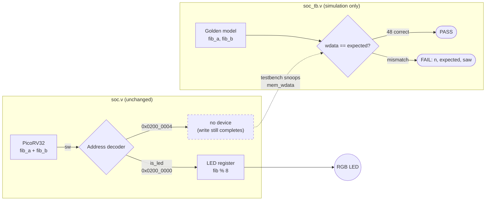

# Level 3 Report: Fibonacci, Checked Against a Golden Model

**Board:** UPduino v3.0 (iCE40UP5K) · **CPU:** [PicoRV32](https://github.com/YosysHQ/picorv32) · **Builds on:** [Level 2](../level2_icebram/RECAP.md)

## Summary

The CPU computes the first 48 Fibonacci numbers, `fib(0)` to `fib(47)`, in C. A self-checking testbench compares **every 32-bit result** with its own independent model. Level 1 could only check 3 bits (the LED); this level checks real arithmetic.

**No hardware changed.** `soc.v`, `top.v` and the `Makefile` are identical to Level 2. Only the firmware and the testbench changed, so a firmware update still reaches the board in ~7 s.

**Result:** `PASS: 48 Fibonacci numbers correct` at 35,559 ns, and the board shows the expected 12-color pattern.

## How It Works



**1. A result slot with nothing behind it.** The firmware writes each value to `0x0200_0004` (`OUT`). No device lives there. The bus still answers every address (`soc.v`: `mem_ready <= mem_valid && !mem_ready`), so the CPU keeps going, and on the board the value simply disappears. The low 3 bits also go to the LED (`LED = fib % 8`).

**2. The testbench watches the bus.** It reads signals inside the SoC by hierarchical name (`dut.mem_valid`, `dut.mem_wdata`, …) and captures a value only when:

```
mem_valid && mem_ready && mem_addr == 32'h0200_0004 && mem_wstrb == 4'hf
```

`mem_valid` stays high for 2 clock edges per request and `mem_ready` for 1. Requiring both catches **each write exactly once**: a transfer happens when valid and ready are high on the same edge.

**3. Golden model.** The testbench computes Fibonacci itself, with the same running-pair algorithm as the firmware:

| | Firmware (`main.c`) | Golden model (`soc_tb.v`) |
|---|---|---|
| Step | `next = a + b; a = b; b = next;` | `a <= b; b <= a + b;` |
| Why it differs | C needs a temporary | `<=` reads the old values, no temporary needed |

**4. Boundary test.** `fib(47) = 2,971,215,073` is the largest Fibonacci number that fits in 32 bits, and its top bit is set. Everything is `unsigned` (`unsigned int` in C, plain `reg [31:0]` in Verilog), so it is never misread as negative.

| File | Change |
|---|---|
| `firmware/main.c` | Fibonacci with a running pair of `unsigned int`; each value to `OUT` and `LED` |
| `soc_tb.v` | LED checker replaced by a bus checker + golden model; PASS after 48 values |
| `soc.v`, `top.v`, `Makefile` | Unchanged from Level 2 |

## On the Board

Fibonacci mod 8 repeats every 12 values (the *Pisano period*), so the LED cycles through this pattern 4 times per 48 values:

| n | 0 | 1 | 2 | 3 | 4 | 5 | 6 | 7 | 8 | 9 | 10 | 11 |
|---|---|---|---|---|---|---|---|---|---|---|---|---|
| fib(n) | 0 | 1 | 1 | 2 | 3 | 5 | 8 | 13 | 21 | 34 | 55 | 89 |
| mod 8 | 0 | 1 | 1 | 2 | 3 | 5 | 0 | 5 | 5 | 2 | 7 | 1 |
| Color | off | red | red | green | yellow | pink | off | pink | pink | green | white | red |

The pairs `1, 1` and `5, 5` look like one longer color, so you see 10 changes per 12 values.

## Hardware Numbers

From nextpnr, for the full SoC:

| Resource | Used | Note |
|---|---|---|
| Logic cells | 1,925 / 5,280 (36%) | |
| Block RAM | 20 / 30 (66%) | 16 for the 8 KB RAM, the rest most likely PicoRV32's register file |
| DSP blocks | 0 / 8 | Free for the planned MAC instruction |
| Max frequency | 25.45 MHz | Running at 12 MHz: about 2× margin |

**Critical path:** PicoRV32's ALU adder carry chain → branch compare → instruction fetch control (39.3 ns: 17.4 ns logic, 21.9 ns routing).

## Verification

| Test | Result |
|---|---|
| `make sim` | ✓ `PASS: 48 Fibonacci numbers correct` at 35,559 ns |
| Board: LED pattern | ✓ off, red, green, yellow, pink, off, pink, green, white, red … |
| Break on purpose: `fib_b = 2` in `main.c` | ⏳ expect `FAIL: n=1 expected 1, saw 2` |

## Lessons

- `long long` on a 32-bit CPU turns one `+` into 4 instructions (two adds plus carry handling). Match the data width to the hardware.
- Recomputing `fib(n)` from scratch for each `n` is O(n²). A running pair is O(n) and mirrors the golden model.
- With `fib_b = 0`, gcc proved every output was 0, deleted the math, and stored the constant `zero`. Read `make dump` when results look suspicious.
- A test has blind spots: a `return` that ends `main` after one pass still passes simulation, because the testbench stops after 48 values.

## Reproduce

```bash
make sim      # PASS: 48 Fibonacci numbers correct
make flash    # ~7 s after the first hardware build (Level 2 fast path)
```
